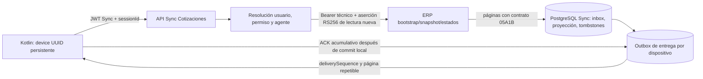

# COT-MOBILE-05B-1 — Contrato de sincronización de estados de Cotizaciones

**Estado:** diseño aprobado para preparar implementación 05B-2. Este documento define Sync → Kotlin y el consumo durable ERP → Sync. No modifica COT-MOBILE-05A1B ni el payload comercial de captura.

**Alcance de esta fase:** lectura de código y documentación; no se modificaron código funcional, esquema, configuración, ERP o Kotlin; no se ejecutaron migraciones, pruebas, despliegues, reinicios ni commits.

## 1. Decisiones definitivas

1. Se exige `cotizaciones.ver` efectivo para leer estados. `cotizaciones.crear` permanece independiente y no concede permiso de lectura. Las dos operaciones conservan emisores/políticas de autorización separadas.
2. Cada petición a cualquiera de los tres endpoints ERP crea una aserción RS256 nueva con `operation=LEER_ESTADOS_COTIZACIONES`, `jti` UUID nuevo, identidad comercial resuelta por Sync, agente único, dispositivo UUID, `iss`, `aud`, `iat`, `exp` y `kid`. Se conserva en paralelo la autenticación técnica bearer ERP.
3. La lectura reutiliza el registro APP de claves y parámetros RSA sólo cuando `kid`, algoritmo, issuer, audience y clave pública coinciden con el entorno ERP. No reutiliza la aserción de creación. Ante mismatch la lectura falla cerrada y no intenta degradar a autenticación técnica solamente.
4. Las credenciales de lectura usan configuración ERP Cotizaciones explícita y estricta. La ruta de lectura no acepta token/usuario/contraseña genéricos como fallback. La configuración actual de captura puede conservar su comportamiento para no afectar el payload/flujo de creación; el cliente de lectura será un bean/servicio dedicado que requiere sus propias propiedades no vacías.
5. En cada operación Sync se resuelven de nuevo usuario ERP activo, rol `AGENTE` o `VENDEDOR`, permiso efectivo `cotizaciones.ver` y exactamente un agente asociado. Sync deriva usuario y agente del principal autenticado/BD. Ningún `agenteId` de Kotlin participa en autorización.
6. La sesión de estados queda particionada por `usuarioErpId + agenteErpId + dispositivoId + generation`. `dispositivoId` es UUID persistente de Kotlin y un namespace, no secreto ni autenticador. Cada sesión tiene un `sessionId` aleatorio propio y opaco. Todas las lecturas y confirmaciones verifican JWT actual, actor ERP actual, agente actual, device UUID y pertenencia de `sessionId`.
7. No se cambia el login ni la forma de sus DTOs. La identidad queda ligada a la sesión específica de Cotizaciones al crearla; cada petición posterior revalida actor y sesión. El access JWT actual identifica correo y vence según configuración (15 minutos por defecto); el refresh dura 7 días por defecto. El lease local de 24 horas es separado de ambos tokens.
8. ERP → Sync conserva un cursor independiente por sesión, basado exclusivamente en `eventId`. Sync persiste exactamente `nextCursor` ERP dentro de la misma transacción que el inbox de eventos, deduplicación, reconciliación y cola de entrega.
9. Sync → Kotlin usa secuencia durable independiente (`deliverySequence`) por sesión y confirmación acumulativa explícita. La cola conserva eventos aun después de que el cursor ERP avance. Kotlin confirma sólo después de confirmar su transacción local.
10. Snapshot y cambios forman una sola secuencia de entrega: todo el snapshot materializado se asigna primero a secuencias de entrega; los eventos incrementales se secuencian después. Kotlin no solicita eventos hasta confirmar la última página del snapshot.
11. El permiso offline vale como máximo 24 horas desde la última revalidación remota exitosa. Es configurable en Sync con límite superior fijado en 24 horas. Al vencer, Kotlin bloquea la visualización de Cotizaciones sincronizadas hasta revalidar. Una falla transitoria no equivale a revocación y no extiende el lease.
12. Revocación documental (evento `visible=false`) oculta el documento afectado y conserva tombstone; revocación de sesión bloquea y purga la proyección de esa sesión; falla temporal conserva datos sólo mientras el lease de 24 horas siga vigente. No se promete revocación inmediata mientras el dispositivo esté desconectado.
13. Sesiones activas y datos se almacenan en PostgreSQL de Sync. Todas las instancias coordinan por bloqueos/leases de fila en esa base; no se usa memoria de proceso como checkpoint.
14. Reiniciar es una operación explícita que crea `generation + 1` y nuevo `sessionId`; no reutiliza snapshot, entrega, cursor ni tombstones de la generación previa.

## 2. Hallazgos de compatibilidad y permisos

### `cotizaciones.ver`

El permiso existe en ERP como `ErpPermissions.Cotizaciones.COTIZACIONES_VER = "cotizaciones.ver"`. La migración `src/main/resources/db/migration/V20261006_02__cotizaciones_permisos.sql` lo crea en guard `web` y lo asigna al rol `super_admin`. ERP tiene gestión de permisos efectivos por rol y permiso directo; `EffectiveAccessRepository` combina permisos del rol y asignaciones directas. Por tanto, la condición solicitada es implementable sin tocar el permiso de captura.

El seed no demuestra que un usuario móvil de producción tenga el permiso. No se consultó ni se infiere el estado de producción. Sync debe comprobar la asignación efectiva en cada acceso; los vendedores que no lo tengan recibirán 403 sin feed. La regla de lectura y la de creación permanecerán separadas.

En Sync, `SyncService.identidadCotizaciones` hoy comprueba `cotizaciones.crear`, no `cotizaciones.ver`; se añadirá una resolución de lectura independiente. El endpoint de estados exigirá además la autorización de Sync (`SINCRONIZAR_DATOS`) vigente. Esto no requiere cambiar la identidad ni el contrato de login móvil.

### Integración ERP sin interferir con captura/Pedidos

La configuración actual de `erp.cotizaciones.*` tiene fallback a `erp.*` y el cliente se comparte para revisión/captura Cotización. Para satisfacer lectura estricta sin alterar captura, 05B-2 debe agregar configuración `erp.cotizaciones.read.*` obligatoria y un cliente read-only separado con timeout/re-login propios o reutilizar únicamente el helper autenticador después de validar que recibió credenciales explícitas. No debe leer el fallback genérico. El bean `erpPedidoClient`, las rutas de Pedido, `PedidoEstadosService`, `PedidoEstadosController` y sus cursores quedan fuera de cambios funcionales.

La configuración no contiene evidencia verificable de que los valores de `kid`, emisor, audiencia, clave pública y username técnico activos en producción coincidan con ERP. La aplicación fallará cerrada si la configuración falta o ERP rechaza la aserción. No se asumen secretos ni despliegues.

## 3. Arquitectura y flujo de información



Sync contiene dos planos persistentes:

- **Recepción ERP:** un worker por sesión lógica solicita feed con el cursor fuente de esa sesión; guarda los eventos admitidos, aplica deduplicación/reconciliación y actualiza cursor ERP atómicamente.
- **Entrega Kotlin:** páginas inmutables con secuencia propia por dispositivo. Las consultas no leen directamente el cursor ERP. Los ACK retiran disponibilidad después de la política de retención, no condicionan el avance ERP.

La inicialización materializa una vista snapshot estable por generación. Un worker puede drenar el feed desde `startCursor` mientras pagina el snapshot; conserva las páginas de feed en inbox buffer y no las coloca delante del snapshot. Al terminar de descargar y persistir snapshot, Sync crea las filas de entrega del snapshot, reinterpreta/aplica el inbox desde el corte por `eventId` y agrega los incrementales después del snapshot. Los eventos pueden repetir una versión ya presente en snapshot; se conserva la regla de reconciliación por versión y Kotlin también debe ignorar regresiones.

## 4. Modelo lógico de persistencia

Los nombres siguientes son lógicos; las tablas/columnas físicas se definirán en la migración de 05B-2. No ejecutar DDL en esta fase.

| Tabla lógica | Contenido y claves |
|---|---|
| `cot_sync_session` | PK `session_id UUID`; `usuario_erp_id`, `agente_erp_id`, `device_id UUID`, `generation BIGINT`, `state`, `offline_valid_until`, `start_cursor`, `erp_cursor`, `max_cotizacion_id`, `snapshot_after_id`, `snapshot_complete`, `snapshot_acked_sequence`, `delivery_acked_sequence`, `last_offered_sequence`, `next_delivery_sequence`, timestamps, `lease_owner`, `lease_until`, `row_version`. Unique `(usuario_erp_id, agente_erp_id, device_id, generation)`; índice por `(device_id, state)` y por sesiones activas de identidad. No guardar tokens ni credenciales. |
| `cot_sync_snapshot` | Imagen de snapshot por `session_id + snapshot_ordinal`; UNIQUE `(session_id, cotizacion_uuid)` y `(session_id, snapshot_ordinal)`. Campos exactos de documento según ERP (`erpId`, `cotizacionUuid`, `estado`, `version`, `agenteId`, `updatedAt`) más estado de entrega. Retener sólo hasta completar entrega y periodo configurado. |
| `cot_sync_projection` | Proyección actual por `session_id + cotizacion_uuid` UNIQUE. Guarda los campos mínimos de estado visibles, versión, `event_id` aplicado y visibilidad. FK session. Index `(session_id, visible, cotizacion_uuid)`. |
| `cot_sync_event_inbox` | Eventos ERP validados, buffer del corte y ledger fuente. UNIQUE `(session_id, event_id)`. Guarda el JSON permitido normalizado/hash, UUID, versión, estado, visibilidad y fecha/event type según contrato; la revocación conserva sólo los nulos entregados por ERP. Índice `(session_id, event_id)` cubierto por la clave. |
| `cot_sync_tombstone` | Revocación por `(session_id, cotizacion_uuid)` UNIQUE con versión y `event_id` de revocación, fecha y razón genérica `VISIBILIDAD_RETIRADA`; jamás propietario nuevo ni estado ajeno. Evita reaparición de eventos viejos. |
| `cot_sync_delivery` | Outbox durable por dispositivo/sesión; PK o UNIQUE `(session_id, delivery_sequence)`. Tipo `SNAPSHOT`/`EVENT`, referencia a fila durable, `event_id` nullable para snapshot, versión, fecha de creación. UNIQUE `(session_id, event_id)` donde `event_id` no sea null. Index `(session_id, delivery_sequence)` para páginas y ACK. |

La clave de aislamiento siempre contiene `session_id`; nunca se consulta una proyección sólo por UUID. Los FK/cascades se limitan a datos de Cotizaciones de esa sesión. Identidad, cursor y colas de Pedido no comparten tablas ni claves.

### Reglas de reconciliación

- `eventId` se deduplica dentro de la sesión comercial (`UNIQUE(session_id,event_id)`). Repetición con hash/campos idénticos es no-op. Mismo ID con contenido distinto marca `REQUIERE_REINICIO` y genera error de integridad.
- Para cada UUID sólo se reemplaza proyección si `version` entrante es mayor. Versión menor se registra como recibida/deduplicada pero no cambia proyección. Versión igual con estado y visibilidad iguales es no-op; igual con contradicción de estado/visibilidad es conflicto y suspende sesión.
- `visible=false` elimina/oculta la fila comercial de proyección, registra tombstone con UUID, versión y eventId, y agrega evento mínimo de retiro a delivery. Nunca copia agente o estado no visible.
- Un `visible=true` sólo se entrega en sesión autorizada por ERP. Una versión inferior a tombstone no puede volver a crear proyección. Una reaparición legítima exige versión superior o nueva generación obtenida por bootstrap actual; jamás se borra el tombstone por un evento antiguo.
- La versión de snapshot define estado inicial. Eventos desde `startCursor` se procesan después del staging del snapshot y antes de emitir el incremental; la regla de versión resuelve solapamiento.

## 5. Máquina de estados durable

Estados normativos:

- `INICIALIZANDO`: bootstrap fijado; snapshot incompleto o aún no confirmado por Kotlin. Se permiten GET/ACK de snapshot, no incremental.
- `ACTIVA`: snapshot completo y último elemento del snapshot confirmado; incrementales habilitados. Revalidación y recepción ERP continúan en background aunque Kotlin esté desconectado.
- `REQUIERE_REINICIO`: respuesta ERP/protocolo/integridad no recuperable, cursor inconsistente, cambio de identidad que requiere nueva vista, o retención operativa excedida. Datos de esa generación quedan no entregables; se exige reset explícito.
- `REVOCADA`: ERP confirma falta de permiso/usuario/agente, Sync ve identidad inactiva o Kotlin revoca sesión. Se bloquean lecturas y ACK nuevos. Se oculta/purga proyección de esa sesión según política; registros mínimos de auditoría se retienen sin datos comerciales.

Transiciones:

```text
POST sesión → INICIALIZANDO → (snapshot persistido y ACK completo) → ACTIVA
ACTIVA → 403 ERP/permiso o usuario inactivo → REVOCADA
INICIALIZANDO/ACTIVA → contradicción, cursor inválido, snapshot irrecuperable → REQUIERE_REINICIO
REVOCADA/REQUIERE_REINICIO → POST reset autorizado → nueva sesión generation+1 en INICIALIZANDO
```

Proceso:

1. Sync valida JWT, `SINCRONIZAR_DATOS`, cuenta activa, `cotizaciones.ver` efectivo y relación única usuario/agente; valida `deviceId` UUID.
2. `POST sesión` reanuda la sesión vigente exacta de esa identidad/dispositivo o crea generación inicial. Si cambió usuario/agente, no reusa sesión: revoca o marca reset requerido a la anterior y crea sólo bajo endpoint de reinicio explícito.
3. Sync llama ERP bootstrap con aserción fresh y persiste `startCursor`, `maxCotizacionId`, `erp_cursor=startCursor`, `snapshot_after_id=0` antes de pedir páginas. No inicia snapshot con `cursor=0`.
4. Recupera snapshot con los parámetros ERP exactos `afterId`, `maxCotizacionId`, `limit`. Persiste cada página y `nextAfterId` transaccionalmente. En paralelo puede drenar estados desde `startCursor` en inbox buffer, persistiendo `nextCursor` exacto; su aplicación a la proyección/cola Kotlin espera hasta haber materializado snapshot.
5. Una página snapshot repetida se vuelve no-op por ordinal/UUID. Si Sync se interrumpe, workers leen cursores/checkpoints confirmados y continúan con `afterId` guardado y corte original; no vuelven a bootstrap mientras estado no indique pérdida/invalidación.
6. Al persistir página final snapshot (`hasMore=false`), Sync asigna secuencias de entrega snapshot en orden estable, aplica inbox de eventos por orden `eventId` contra proyección/tombstones y crea filas de delivery incremental posteriores al rango snapshot. Mantiene `INICIALIZANDO` hasta ACK del último elemento snapshot.
7. Kotlin puede pedir snapshot repetido desde `deliverySequence=acked+1`. Cuando confirma el elemento terminal del snapshot, Sync cambia a `ACTIVA`. Luego el worker mantiene la ingesta ERP y agrega eventos nuevos a delivery por orden de llegada ERP.

Para evitar pérdida entre corte y cambio incremental: cada respuesta ERP posterior al corte queda durable en inbox aun si Kotlin no está conectado; el cursor fuente sólo se avanza dentro de su transacción. Los eventos recibidos durante paginación del snapshot se retienen como buffer. La entrega incremental se habilita sólo después del ACK de snapshot. El outbox de entrega no se deriva del inbox eliminado ni del cursor actual; es una cola durable independiente.

## 6. Protocolo ERP → Sync y Sync → Kotlin

### ERP → Sync

Se conserva exactamente COT-MOBILE-05A1B:

- `GET /api/cotizaciones/sync/bootstrap`
- `GET /api/cotizaciones/sync/snapshot?afterId={nextAfterId}&maxCotizacionId={maxCotizacionId}&limit={1..100}`
- `GET /api/cotizaciones/sync/estados?cursor={erpCursor}&limit={1..100}`

Cada request lleva autenticación técnica existente y header `X-Cotizacion-Assertion` con aserción fresh de lectura. Bootstrap proporciona `startCursor`, `maxCotizacionId`; snapshot devuelve `documents`, `nextAfterId`, `hasMore`; eventos devuelven `events`, `nextCursor`, `hasMore`. `nextCursor` es el último evento visible devuelto y en página vacía conserva el cursor recibido. Sync guarda el valor exacto; no lo incrementa ni lo sustituye por timestamp/máximo global.

Sync procesa una página ERP fuera de transacción de red y la confirma dentro de transacción PostgreSQL:

1. lock de sesión, comprobar estado, identidad, `device_id`, generation y cursor esperado;
2. insertar eventos inbox con deduplicación;
3. reconciliar por UUID/versión/tombstone;
4. crear filas de entrega una sola vez si ya es admisible entregarlas (para inicialización, después del snapshot);
5. persistir `nextCursor` exacto;
6. commit.

Si llega respuesta de un worker que perdió lease o cursor esperado cambió, descartar esa respuesta y volver a leer el checkpoint. No confirmar cursor ni filas parciales.

### Sync → Kotlin: numeración y ACK

`deliverySequence` es un contador `BIGINT` por sesión asignado por Sync dentro de la transacción que inserta en `cot_sync_delivery`, nunca derivado de `eventId`. Se asigna primero a cada documento del snapshot; luego a cada evento incremental. Es estable para una fila durante reintentos. Un evento con `eventId` repetido no obtiene nueva secuencia.

Kotlin solicita `afterSequence=lastAckedSequence` y recibe una página ordenada. Persiste toda la página en una transacción local: snapshot reemplaza/actualiza dataset de esa sesión; eventos reconcilian documento/tombstone por UUID+versión; luego confirma `lastAckedSequence=toSequence` dentro de la misma transacción. Después envía ACK a Sync. Si el ACK se pierde, Sync repite los mismos elementos; Kotlin deduplica por `deliverySequence`/`eventId` y versiones. Si la respuesta se pierde, Kotlin no avanza y vuelve a solicitar la misma página. No hay pérdida entre recepción y confirmación.

ACK es acumulativo y monotónico. Sync sólo acepta `ackThroughSequence` no mayor al mayor sequence entregado a esa sesión y no menor que ACK previo; ACK repetido igual es 200 idempotente. Confirmar saltando filas no entregadas produce 409. El cliente puede confirmar un snapshot y eventos por separado; el endpoint no permite eventos hasta snapshot terminal confirmado.

Cuando Kotlin está desconectado, worker Sync continúa guardando páginas fuente y creando delivery rows. El ACK sigue pendiente por dispositivo; avanzar `erp_cursor` no libera ni borra `cot_sync_delivery`.

## 7. Contrato HTTP Sync → Kotlin

Todos los endpoints requieren access JWT Sync vigente y `SINCRONIZAR_DATOS`. Las rutas de sesión consultan permiso ERP efectivo y actor actual. JSON UTF-8. El cliente no envía `agenteId` en ningún body.

### Crear o reanudar sesión

`POST /api/sync/cotizaciones/estados/sesion`

```json
{ "dispositivoId": "c0a8012e-8a2d-4c9c-aaf4-9a8f58a1f9b2" }
```

Respuesta 200 al reanudar o 201 al crear:

```json
{
  "sessionId": "uuid-de-sesion",
  "generation": 1,
  "state": "INICIALIZANDO",
  "snapshot": { "nextDeliverySequence": 1, "hasMore": true },
  "lastAckedSequence": 0,
  "offlineAuthorization": { "valid": true, "validUntil": "2026-10-14T12:00:00Z" }
}
```

La respuesta no identifica ni acepta agente. `deviceId` debe ser UUID canónico. `sessionId` es un localizador no secreto; no reemplaza JWT ni validación de actor.

### Obtener snapshot

`GET /api/sync/cotizaciones/estados/sesion/{sessionId}/snapshot?afterSequence={n}&limit={1..100}`

Sólo estado `INICIALIZANDO`, snapshot ya materializado. Respuesta:

```json
{
  "sessionId": "uuid-de-sesion",
  "generation": 1,
  "items": [{
    "deliverySequence": 1,
    "document": {
      "erpId": 32,
      "cotizacionUuid": "11111111-2222-4333-8444-555555555555",
      "estado": "VIGENTE",
      "version": 2,
      "agenteId": 12,
      "updatedAt": "2026-10-13T12:00:00Z"
    }
  }],
  "fromSequence": 1,
  "toSequence": 1,
  "snapshotComplete": true,
  "hasMore": false
}
```

La forma de `document` conserva los campos del snapshot ERP; `deliverySequence` es metadato de transporte Sync. `snapshotComplete` significa que esta página contiene el final materializado; la sesión sólo pasa a `ACTIVA` después del ACK correspondiente. Límite Sync 1–100. `afterSequence` debe ser el ACK previo (o 0 para primera página); si el cliente pide un salto, responde 409.

### Consultar eventos incrementales

`GET /api/sync/cotizaciones/estados/sesion/{sessionId}/eventos?afterSequence={n}&limit={1..100}`

Sólo `ACTIVA`. Respuesta:

```json
{
  "sessionId": "uuid-de-sesion",
  "generation": 1,
  "events": [{
    "deliverySequence": 18,
    "eventId": 23,
    "cotizacionUuid": "11111111-2222-4333-8444-555555555555",
    "erpId": 32,
    "estado": null,
    "version": 3,
    "changedAt": "2026-10-13T13:00:00Z",
    "eventType": "ACTUALIZADA",
    "agenteId": null,
    "visible": false
  }],
  "fromSequence": 18,
  "toSequence": 18,
  "hasMore": false
}
```

Los nombres/campos de cada evento son los de COT-MOBILE-05A1B; `deliverySequence` sólo existe en el envoltorio Sync. Para `visible=false`, `estado` y `agenteId` son null conforme a ERP; Sync no los completa desde proyección ni revela dueño nuevo. Página vacía devuelve `events:[]`, `fromSequence/toSequence` igual al ACK actual, `hasMore=false`; no avanza secuencia.

### Confirmar recepción durable

`POST /api/sync/cotizaciones/estados/sesion/{sessionId}/ack`

```json
{ "ackThroughSequence": 18 }
```

200 con `{ "ackThroughSequence": 18, "state": "ACTIVA" }`. El cliente llama sólo después de commit local. Repetición idempotente. Sync guarda `last_offered_sequence` al servir una página; ACK ausente, no-monotónico, superior al máximo ofrecido o que salte una fila/página genera 409 `ACK_NO_CONTIGUO`. El ACK final del snapshot cambia sesión de `INICIALIZANDO` a `ACTIVA` en la misma transacción que el checkpoint ACK.

### Estado de sesión

`GET /api/sync/cotizaciones/estados/sesion/{sessionId}`

200 devuelve `sessionId`, `generation`, `state`, `snapshotComplete`, `lastAckedSequence`, `lastAvailableSequence`, `offlineAuthorization.valid`, `validUntil` y un código resumido `reasonCode` nullable. No incluye cursores ERP crudos, agente de otros usuarios, credenciales o tokens. Ante actor/device/session mismatch, 404 genérico evita revelar existencia de sesión ajena.

### Revalidar autorización

`POST /api/sync/cotizaciones/estados/sesion/{sessionId}/revalidar`

Sync resuelve identidad y permiso actual, ejecuta una petición ERP idempotente de feed desde el cursor fuente y sólo renueva lease si ERP aceptó la aserción/permiso y Sync persistió la respuesta. 200 devuelve `authorized=true`, `validUntil` (ahora + configuración, máximo 24h), estado y secuencias disponibles. Un evento devuelto se guarda en inbox/delivery según la misma transacción. Si expira el access JWT, Kotlin primero usa el flujo de refresh/login existente; no se añade claim ni campo al login.

### Reiniciar generación

`POST /api/sync/cotizaciones/estados/sesion/{sessionId}/reiniciar`

Body `{ "dispositivoId": "uuid", "expectedGeneration": 1 }`. Requiere identidad autenticada actual y permiso vigente; confirma explícitamente la sesión fuente para evitar reset accidental. Sync cierra/revoca la generación anterior, crea `generation=2` con `sessionId` nuevo y vuelve a bootstrap. No copia ACK, cursores, snapshot, proyección, eventos ni tombstones de la anterior. Responde 201 como creación de sesión inicializando y `{ "oldSessionState":"REQUIERE_REINICIO", "purgeRequired":true }`. El cliente confirma el reset local y conserva su outbox de captura aparte.

### Errores HTTP

Todos usan forma uniforme:

```json
{
  "code": "COTIZACIONES_AUTORIZACION_REVOCADA",
  "message": "La autorización de Cotizaciones requiere revalidación.",
  "retryable": false,
  "phase": "ERP_ESTADOS",
  "sessionState": "REVOCADA",
  "correlationId": "uuid"
}
```

| HTTP | Código/semántica |
|---|---|
| 400 | `REQUEST_INVALIDA`: UUID o formato mal formado. |
| 401 | `SYNC_AUTH_REQUIRED` o `SYNC_TOKEN_EXPIRED`: JWT ausente/inválido; usar login/refresh existente. |
| 403 | `COTIZACIONES_SIN_PERMISO` / `COTIZACIONES_AUTORIZACION_REVOCADA`: usuario activo sin permiso, usuario inactivo o ERP niega lectura; sesión se revoca si la respuesta demuestra pérdida de autorización. |
| 404 | `SESION_NO_ENCONTRADA`: sesión desconocida o no pertenece a actor/device actual. |
| 409 | `ACK_NO_CONTIGUO`, `IDENTIDAD_CAMBIADA`, `SESSION_STATE_CONFLICT` o `ERP_CURSOR_CONFLICT`: no reintentar sin consultar estado; cursor no se fuerza. |
| 410 | `SESSION_REQUIERE_REINICIO` / `SESSION_EXPIRADA`: usar endpoint explícito de reinicio; datos antiguos ya no se entregan. |
| 422 | `LIMIT_FUERA_DE_RANGO`, `DISPOSITIVO_UUID_INVALIDO` o validación semántica. |
| 429 | `RATE_LIMITED`: reintentar tras `Retry-After`. |
| 502 | `ERP_PROTOCOL_ERROR`: JSON/campos no conformes o respuesta de firma persistentemente rechazada tras un retry fresh limitado. |
| 503 | `ERP_UNAVAILABLE`, `SYNC_STORAGE_UNAVAILABLE` o `ERP_TECHNICAL_AUTH_FAILED`; retryable según error. No extiende autorización offline. |

Los errores no devuelven cuerpos de login ERP, bearer/aserción, claves, secretos ni campos comerciales ajenos. Una falla temporal no cambia `state=REVOCADA`; si el lease vence, sólo Kotlin bloquea visualización offline hasta una revalidación exitosa.

El contrato no cambia `POST /api/sync/cotizaciones`, su DTO comercial, las revisiones comerciales ni las respuestas de captura.

## 8. Seguridad, dispositivo y revocación offline

### ID persistente y binding sin cambio de login

Kotlin ya persiste `cotizaciones_dispositivo_id` en `app_config` y genera `desktop-${uuid4()}` en `CotizacionRepository.dispositivoId()`. Esto demuestra persistencia local, pero el formato actual no es UUID canónico y el valor se suministra en la captura.

Para 05B-2, Kotlin generará UUID v4 persistente bare (sin prefijo) en almacenamiento local transaccional; Android deberá proteger la base con sus controles de plataforma. Sync validará UUID canónico y guardará el valor en sesión. Para registros antiguos `desktop-{UUID}`, normalizar sólo el valor de registro de dispositivo al UUID subyacente de forma determinista al actualizar la app; capturas ya preparadas/persistidas conservan el valor congelado que llevaban y la forma del payload de captura no cambia. El ID no es secreto ni prueba de identidad.

Binding concreto sin tocar login:

1. Kotlin envía JWT Sync vigente, `deviceId` sólo al crear/reanudar/resetear sesión; recibe `sessionId`.
2. En cada request posterior envía JWT y `sessionId`; opcionalmente repite `X-Sync-Device-Id` para detectar desalineación.
3. Sync toma actor del JWT y lo resuelve en BD; exige tupla exacta con sesión `(usuarioErpId, agenteErpId, deviceId, generation)`. El device ID o session ID solos no autorizan.
4. Cambio de usuario requiere nuevo JWT y nueva sesión. El JWT anterior no puede consultar la nueva sesión; el usuario nuevo no puede consultar la antigua. Si cambia el agente del mismo usuario, el tuple mismatch cierra la sesión antigua como `REVOCADA`/`REQUIERE_REINICIO` y exige una nueva generación tras autorización actual.
5. Logout local revoca la sesión local y purga los datos de esa sesión; el endpoint remoto de revocación opcional se incluye en 05B-2 para cuando haya red. El login móvil no se extiende ni se rompe.

Este binding evita reutilización accidental/cross-account, pero no acredita hardware. Un UUID copiado junto a una cuenta autenticada del mismo actor puede localizar esa sesión; el acceso a datos sigue exigiendo actor, permiso y JWT. No se añade secreto de dispositivo ni se afirma seguridad de attestation.

### Lease y revalidación

`offlineAuthorization.validUntil` se fija sólo cuando una operación solicitada por Kotlin (crear/reanudar sesión o revalidar) confirma que ERP aceptó la aserción y que la respuesta quedó duradera en PostgreSQL. El worker de fondo que mantiene el feed nunca extiende el lease mientras el dispositivo está desconectado. Configuración `sync.cotizaciones.offline-authorization-hours` tiene máximo duro de 24 y valor inicial 24; una instancia no puede ampliar sobre 24h por configuración. Kotlin guarda expiry UTC junto con `sessionId` y generation en su base; al arrancar y antes de mostrar Cotizaciones comprueba hora/lease. Al llegar expiry bloquea vista hasta endpoint revalidar exitoso.

- **Revocación de documento:** evento autorizado `visible=false`; Kotlin elimina/oculta la Cotización en la misma transacción que registra su `deliverySequence`, conserva tombstone, confirma y aplica UI de inmediato.
- **Revocación de sesión:** permiso `cotizaciones.ver` ausente, usuario inactivo, actor/agente inválido o cualquier 403 ERP; Sync falla cerrado, marca sesión `REVOCADA` con motivo genérico, detiene worker/entregas y purga snapshot/proyección/pendientes comerciales de esa sesión en Sync (conserva auditoría mínima no comercial). Un 403 por cuenta técnica mal configurada también cierra esa generación, pero no se etiqueta como revocación comprobada del permiso comercial. Kotlin bloquea inmediatamente, purga esa sesión local y limpia lease. Capturas pendientes de envío se preservan en tabla/cifrado/outbox separado, sin presentarlas como Cotizaciones autorizadas.
- **Falla temporal:** timeout, DNS, 5xx, 429 o indisponibilidad; no marca revocación ni renueva lease. Se reintenta con backoff. Kotlin puede mostrar copia ya autorizada mientras lease sea válido; a las 24h se bloquea aunque la red siga fallando.
- **401 ERP:** si credencial bearer recibe 401, re-login técnico una sola vez; si el 401 es de assertion, emitir assertion nueva una vez. Rechazo persistente es error de autenticación/configuración, no prueba suficiente por sí sola de revocación comercial; no se marca sesión revocada automáticamente.
- **403 ERP:** se bloquean inmediatamente nuevas entregas de esa sesión y se marca `REVOCADA` en modo fail-closed. Se registra un código genérico `ACCESS_DENIED`; no se afirma que el vendedor perdió el permiso si el detalle no lo demuestra, ya que una configuración de cuenta técnica también puede denegar. Una nueva generación sólo inicia tras autorización y llamada ERP exitosas.
- **Vencimiento durante una captura pendiente:** se bloquea visualización de Cotizaciones autorizadas; la fila de captura pendiente permanece cifrada/separada y su POST de creación conserva UUID/body congelados. En línea, puede enviarse sólo bajo las reglas existentes y permiso `cotizaciones.crear`; nunca se convierte por ello en documento recibido/visible. Conciliación se ofrece cuando el usuario vuelva a autenticarse y tenga permisos correspondientes.

La política reconoce que dispositivo offline no recibe revocación remota inmediata. Su límite de exposición funcional es el lease de 24h en Kotlin; robo/modificación del reloj o extracción del almacenamiento local son riesgos de plataforma, no controles que Sync pueda eliminar.

## 9. Concurrencia y operación multi-instancia

- No sostener una transacción SQL abierta durante HTTP ERP. Worker reclama sesión con `SELECT ... FOR UPDATE SKIP LOCKED` o lease (`lease_owner`, `lease_until`), lee expected cursor, hace HTTP y luego abre transacción corta para lock/revalidar estado, identity/generation/cursor, persistir página y commit.
- El commit incluye inbox/event ledger, proyección/tombstone, delivery outbox y nuevo checkpoint ERP. Unique constraints resuelven carrera de duplicado; en conflicto se vuelve a cargar sesión y se reconoce como no-op si hash coincide.
- El cursor incremental tiene compare-and-set: actualizar sólo si `erp_cursor=cursor solicitado`, asignar respuesta `nextCursor` exacta. Un worker viejo no puede sobreescribir avance nuevo.
- Secuencia Kotlin se asigna bajo lock de fila de sesión y se incrementa en la misma transacción del insert outbox. ACK tiene actualización monotónica bajo el mismo lock. Page reads son deterministas por secuencia y entrega repetible.
- La sesión snapshot usa checkpoints de página (`snapshot_after_id`) y cortes inmutables. Un reintento de página mantiene snapshotOrdinal/UUID UNIQUE. Cambio de respuesta al repetir el mismo `afterId` que contradiga filas ya persistidas invalida generación y requiere reset.
- `SKIP LOCKED`/lease permite múltiples instancias procesando sesiones distintas; la fila/session lock serializa una sola sesión. Worker caído se recupera al expirar lease. Límites de timeout de red no superan lease; si se necesita renovar, hacerlo sin permitir commit tardío.
- Los endpoints de Kotlin no manejan worker localmente ni consultan caché en memoria. Un ACK y un proceso background pueden competir, pero sólo bloquean fila session breve y conservan invariantes.
- El plan no modifica el lock/advisory ni las transacciones del outbox ERP; Sync es consumidor externo.

## 10. Retención y recuperación

Política propuesta para que desconexión no implique pérdida silenciosa:

- No borrar fila `cot_sync_delivery` sin ACK durable. Fila no confirmada conserva la entrega hasta ACK, revocación de sesión o reset explícito. Si el volumen supera umbral configurado, detener el worker para esa sesión y devolver `409/410` de capacidad/reset; no descartar pendientes automáticamente.
- Tras ACK, retener delivery rows 30 días para replay operativo y luego purgar en lotes. El checkpoint `delivery_acked_sequence` y estado actual/tombstones permanecen; requests con secuencia anterior al piso retenido reciben `410 CURSOR_DE_ENTREGA_EXPIRADO` y requieren reset.
- Sesiones sin uso por 180 días se vencen (`REVOCADA`/`SESSION_EXPIRADA`), sus filas comerciales/delivery se purgan, se conserva tombstone técnico de sessionId/generation 90 días para rechazar replays, y se crea generación nueva sólo mediante reset/bootstrap.
- Tombstones del dataset se conservan mientras la sesión esté activa y al menos 90 días después de cierre si no tienen datos comerciales. El nuevo bootstrap usa namespace de generación distinto, por lo que un tombstone viejo nunca puede autorizar ni contaminar proyección nueva.
- Inbox de eventos confirmados en Sync puede compactarse después de crear y confirmar la fila de delivery fuente; retener 30 días para diagnóstico/replay. `eventId` aplicado y hash mínimo se retienen hasta fin de sesión para idempotencia, sin payload comercial completo cuando delivery ya está confirmado.
- Snapshot staging se purga después de confirmación final y 30 días; la proyección activa permanece hasta revocación/expiración para soporte/resync. No duplicar documentos sin límite: índices, partición/lotes mensuales donde volumen lo amerite, métrica por filas/bytes y alertas de cola no confirmada.
- Los workers deben alertar por edad del evento pendiente, cursor ERP sin avance, falta de lease, sesión inicializando fuera del SLO, crecimiento de outbox y errores de autenticación. No loguear token/aserción, body de login ni datos del documento.

El contrato 05A1B no declara política de retención/borrado del outbox ERP. Esta fase no inventa una duración ni modifica ERP. La implementación depende de la operación del ERP manteniendo legibles los eventos completos desde `startCursor` mientras Sync los consume; se debe comprobar que no haya cleanup concurrente en el entorno de ejecución. Esta es una dependencia operativa a validar, no evidencia de que hoy se pierdan eventos.

## 11. Matriz de pruebas para 05B-2

| Escenario | Resultado exigido |
|---|---|
| Permiso `ver` ausente y permiso `crear` presente | POST/GET/revalidar 403; no se emite read assertion ni se llama feed; creación existente sigue su autorización propia. |
| `ver` directo, por rol y super_admin | Resolver fuente efectiva correcta; cuenta técnica nunca actúa como vendedor. |
| Usuario inactivo, rol no permitido, cero o múltiples agentes | Denegar antes del feed; sin sesión nueva ni cursor cambiado. |
| Agente enviado como parámetro malicioso | Se ignora/rechaza; aserción usa agente derivado del actor. |
| Credenciales read sin configurar o sólo credencial genérica | Fallo cerrado; creación y cliente Pedidos conservan configuración actual. |
| Claims de aserción | RS256, `kid`, issuer/audience y operación exactos, UUID jti fresh cada request, sin claims de creación. |
| Device UUID persistente y reinicio de app | Mismo UUID tras reinicio; distintas instalaciones UUID distintas; `desktop-{UUID}` migra determinísticamente sin editar capturas congeladas. |
| Misma persona con dos dispositivos | Sesiones, snapshot, fuente y delivery cursors/ACK independientes. |
| Cambio de usuario/agente/dispositivo | Session ID ajeno responde 404; asociación cambiada revoca/impide anterior y exige generación nueva. |
| Bootstrap vacío y con documentos | Campos ERP exactos, checkpoint del corte durable antes del snapshot; entrega consistente y ACK terminal. |
| Snapshot mult página e interrupción | Reanuda tras `snapshot_after_id` guardado; no duplica ni omite; mismo corte/max ID. |
| Evento entre páginas de snapshot | Se almacena desde `startCursor` en inbox buffer y se agrega después de secuencias snapshot; versión cliente evita regresión. |
| Evento después de corte | Incremental parte exactamente de `startCursor`; no se sustituye por cero/max global. |
| Página estados vacía | Se conserva el cursor recibido y no se crea delivery sequence. |
| `nextCursor` menor/igual con eventos o `hasMore` sin progreso | Error de protocolo, cursor inmóvil, worker backoff/requiere investigación; sin loop ni avance. |
| Evento repetido y replay de página | UNIQUE eventId evita fila doble; same payload no-op y cursor consistente. |
| Mismo UUID con versión menor/mayor/igual contradictoria | Menor no regresa; mayor aplica; igual compatible no-op; igual contradictoria suspende generación. |
| Revocación `visible=false` | Purga visible inmediata en cliente tras commit; `estado/agenteId=null`; tombstone impide resurrección antigua. |
| Versión antigua después de tombstone | No recrea proyección/entrega visible; se deduplica y registra fuente. |
| Evento posterior visible para nuevo agente | Sólo sesión del nuevo actor recibe documento completo, sin exponer asignación anterior. |
| Kotlin cae antes de commit local | No ACK; misma secuencia se entrega de nuevo. |
| Kotlin cae tras commit local y antes de ACK | Replay duplicado es no-op por secuencia/eventId/version; ACK posterior confirma. |
| ACK repetido, salto o ACK mayor al ofrecido | Repetición igual 200; salto/mayor 409; cursor no se adelanta. |
| Sync avanza ERP con Kotlin desconectado | Delivery outbox conserva todas las filas hasta ACK; reconexión recupera por secuencia. |
| Workers multi-instancia mismos/diferentes sessions | Sólo un lease vigente por sesión; trabajo paralelo entre sesiones; worker tardío no sobrescribe cursor. |
| Lease offline 24h y reloj de UI | Lease se renueva sólo tras confirmación ERP; expirar bloquea vista; fallas no extienden; validar revocación dentro del lease en siguiente contacto. |
| Revocación sesión versus falla temporal | 403 real bloquea/purga; timeout/5xx no marca revocada y no renueva lease. |
| Expira lease con captura local pendiente | Captura queda separada/cifrada, invisible como cotización autorizada; mismo UUID/body se conserva para reconciliación permitida. |
| Reset/resync | Session ID/generation nuevos, no comparten cursores/tombstones/outbox; cliente sustituye conjunto autorizado, conserva outbox de captura separada. |
| Retención/crecimiento | No ACK no se purga; ACK expira con 410 al pasar política; cuotas/alertas detienen sin pérdida silenciosa. |
| Regresión de Pedidos | Mismo DTO/ruta/cursor y resultados de estados de Pedido; sin cambios a historial/cursores/cliente ERP de Pedidos. |
| Captura Cotización existente | DTO comercial, rutas, revisión, UUID e idempotencia conservan contrato; sólo se normaliza device UUID persistente para sesiones futuras. |

## 12. Riesgos residuales y límites demostrables

1. No se verificó que un vendedor/usuario concreto tenga `cotizaciones.ver` en producción; sólo el permiso, el seed de `super_admin` y el mecanismo de asignación están demostrados en código. La denegación por falta efectiva es intencional.
2. No se consultaron valores activos de producción para credenciales técnicas, claves, `kid`, issuer o audience; el despliegue deberá configurar y probar coincidencia con ERP.
3. Kotlin hoy genera `desktop-${uuid4()}` persistido. El requisito de UUID canónico necesita una normalización compatible en la implementación Kotlin; no se hizo en esta fase.
4. El API Sync actual no tiene sesión de dispositivo ni delivery ACK; PostgreSQL de Sync no tiene tablas de estado Cotización. La implementación requiere un script SQL nuevo revisado, pero no una modificación al esquema ERP.
5. La retención de eventos fuente ERP no aparece definida en 05A1B. Debe confirmarse la ausencia de limpieza antes de UAT; si hay retención/borrado finito inferior al tiempo de ingestión, hace falta acuerdo operativo con ERP.
6. Lease 24h no impide extracción local ni revocación remota mientras el dispositivo está offline; la política sólo bloquea visualización Kotlin tras expiración o purga al reconectar.
7. UUID de dispositivo y sessionId son localizadores, no credenciales hardware. El aislamiento se funda en JWT, resolución de identidad y verificación en cada request, no en confiar en esos IDs.
8. La lista exacta de status codes funcionales de Sync es nueva y no altera HTTP ERP; Kotlin tendrá que implementar ACK, lease y reset en una fase propia posterior.

No hay contradicción que impida cerrar el diseño. La diferencia entre `desktop-{UUID}` y UUID pedido se resuelve con conversión de identidad futura preservando el valor congelado de capturas pendientes. La separación de credenciales de lectura se implementa en un cliente nuevo y evita cambiar el cliente de creación/Pedidos. La ausencia de asignación productiva individual se resuelve por comprobación efectiva en cada petición y no mediante suposición.

## 13. Dictamen

**LISTO PARA 05B-2.** Las decisiones de seguridad, aislamiento por dispositivo, cursores duales, ACK, snapshot, lease offline, tablas lógicas, concurrencia y recuperación quedan cerradas. La implementación de 05B-2 deberá limitarse a Sync según este contrato, preservar COT-MOBILE-05A1B y Pedidos, y tratar como condiciones de despliegue la configuración real del usuario técnico/llaves y la comprobación de retención operativa del outbox ERP. Ninguna de esas condiciones se presenta como validada en esta fase.
