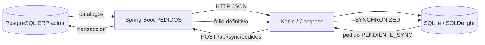

# PEDIDOS / EffyFlow

Sistema de captura y sincronización de pedidos para vendedores. La aplicación Kotlin puede consultar catálogos del ERP, trabajar con una base SQLite local y enviar pedidos pendientes al backend PEDIDOS, que adapta el contrato móvil al modelo PostgreSQL actual.

## Componentes

| Componente | Ruta | Responsabilidad |
|---|---|---|
| App Kotlin/Compose | `App Pedidos\KotlinProject` | Login, sincronización, consulta local, captura offline y envío de pedidos. |
| Backend PEDIDOS | `Backend\effyFlow` | API Spring Boot, seguridad JWT, adaptación ERP, folios, idempotencia y persistencia. |
| Frontend React | `Frontend Web\Web` | Administración parcial de pedidos y surtido. No es necesario para el flujo básico Kotlin. |
| BD y referencias | `BD` | Contiene `respaldo.sql`, una referencia histórica que no representa necesariamente el ERP actual. |
| Documentación | `docs` | Arquitectura, flujos, pruebas, configuración, seguridad y decisiones. |

## Tecnologías

- PostgreSQL 17; `localhost:5432/prueba` fue la base ERP utilizada en las validaciones actuales.
- El backend declara nivel de compilación Java 17 en `pom.xml`; las validaciones conservadas se ejecutaron con JDK 21. Spring Boot 3.5.7, Spring Data JPA, JDBC y Spring Security.
- Kotlin Multiplatform, Compose Multiplatform, Ktor y SQLDelight 2.0.2.
- SQLite para persistencia local.
- React 19, TypeScript, Vite, Axios y Tailwind CSS.

## Arquitectura resumida

El backend se adapta al ERP actual; no se modifica el ERP para imitar el contrato Kotlin. Para stock, la integración transforma `existencias` de PostgreSQL en JSON `stock_productos` y finalmente en SQLite `stock_productos`.

La existencia sincronizada es un snapshot informativo para el vendedor. No bloquea la captura ni la recepción del pedido, no reserva mercancía y no descuenta inventario. El pedido recibido debe pasar después por autorización comercial y surtido; si no hay mercancía suficiente, puede derivar en surtido parcial, backorder o necesidad de compra según la política del cliente/pedido.

## Validación offline local

La última validación confirmó el flujo de una laptop:

- captura de múltiples pedidos completamente offline;
- pedidos conservados localmente como `PENDIENTE_SYNC`;
- reconexión y envío secuencial de la cola;
- reintentos posteriores sin duplicados mediante `uuid_local`;
- pedidos `SYNCHRONIZED` no se reenvían;
- sincronización incremental posterior de catálogos sin modificar pedidos locales;
- errores HTTP 4xx/5xx o excepciones de red conservan el pedido pendiente y se reflejan en `message`.

La cola de pedidos pendientes se procesa ordenada por `id_pedido ASC`. Un fallo de un pedido no corrompe la cola ni marca como sincronizado un pedido no confirmado; los pendientes se reintentan posteriormente.

Estado local al cierre de la validación, solo como evidencia de pruebas locales:

| Recurso | Valor |
| --- | ---: |
| PostgreSQL `pedidos` | 5 |
| PostgreSQL `detalle_pedidos` | 5 |
| PostgreSQL serie 10 `siguiente_folio` | 5 |
| SQLite `pedidos` | 5 |
| SQLite `detalle_pedidos` | 5 |
| SQLite pendientes | 0 |

Estos conteos no son requisitos del sistema ni datos iniciales esperados para otra instalación.

## Requisitos

- Windows para la ruta local actualmente utilizada por la aplicación de escritorio.
- JDK 21.
- PostgreSQL disponible y un esquema ERP preparado con los scripts ya aplicados por el responsable de la base.
- Node.js/npm para el frontend React.
- Variables o configuración local con credenciales propias. No usar valores reales en documentación ni en el código fuente.

## Desarrollo local

1. Preparar PostgreSQL en `localhost:5432/prueba` con `<DB_USER>` y `<DB_PASSWORD>` cuando se quiera reproducir el entorno de validación actual.
2. Configurar el backend para apuntar explícitamente a esa base y elegir un puerto local. `8082` fue un puerto temporal de pruebas, no el puerto definitivo.
3. Ajustar localmente `ServerConfig.BASE_IP` para que Kotlin alcance al backend.
4. Ejecutar el backend con Maven y la app de escritorio con Gradle.
5. Para React, definir `VITE_API_URL` y ejecutar los scripts de npm.

El `application.properties` versionado del backend PEDIDOS todavía apunta a otra configuración de base y puerto. La configuración definitiva debe externalizarse, como se explica en [Configuración de desarrollo](docs/07-configuracion-desarrollo.md). No guardar contraseñas, tokens, secretos JWT ni credenciales de prueba en el repositorio.

## Documentación

- [01 - Arquitectura](docs/01-arquitectura.md)
- [02 - Base de datos local Kotlin](docs/02-base-datos-local-kotlin.md)
- [03 - Sincronización de catálogos](docs/03-sincronizacion-catalogos.md)
- [04 - Flujo del pedido](docs/04-flujo-pedido.md)
- [05 - Folios e idempotencia](docs/05-folios-e-idempotencia.md)
- [06 - Precios, impuestos y totales](docs/06-precios-impuestos-totales.md)
- [07 - Configuración de desarrollo](docs/07-configuracion-desarrollo.md)
- [08 - Pruebas](docs/08-pruebas.md)
- [09 - Estado actual y pendientes](docs/09-estado-actual-y-pendientes.md)
- [10 - Seguridad y configuración pendiente](docs/10-seguridad-y-configuracion-pendiente.md)
- [11 - Registro de decisiones](docs/11-decisions.md)
