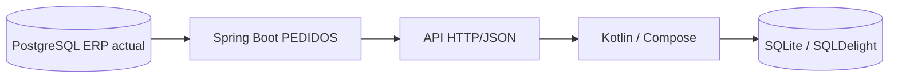
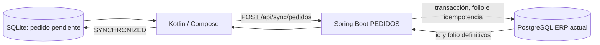

# Arquitectura actual

## Contexto

La base ERP PostgreSQL usada en las validaciones actuales fue `localhost:5432/prueba`. Esto describe el entorno validado, aunque `Backend\effyFlow\src\main\resources\application.properties` todavía apunte a otra configuración versionada. `BD\respaldo.sql` es únicamente el esquema histórico entregado originalmente: no representa el esquema actual de `prueba`.

## Flujo de lectura

## Flujo de escritura

## Responsabilidades

### PostgreSQL ERP

- Es el modelo empresarial vigente.
- Conserva clientes, agentes, productos, precios, impuestos, existencias, series, pedidos y detalles.
- `existencias` es la fuente de stock de la integración actual.
- La existencia sincronizada es un snapshot informativo; no bloquea pedidos, no reserva inventario y no descuenta mercancía al recibir un pedido.
- Mantiene `created_at` y `updated_at` de catálogos sincronizables mediante triggers instalados por `20260820_sync_catalog_timestamps.sql`.
- Protege pedidos con unicidad por `uuid_local` no nulo y por `(serie_id, folio)`.
- No descuenta ni reserva existencias al capturar o recibir un pedido en el flujo actual.

El **ERP Administrativo actual** es un proyecto externo al workspace `C:\BDS\PEDIDOS`. Según la decisión vigente, sus entidades JPA fueron actualizadas para leer `created_at` y `updated_at` con `insertable=false, updatable=false`. Esa implementación no puede verificarse desde este workspace y no debe confundirse con las entidades del backend PEDIDOS.

### Spring Boot PEDIDOS

- Expone autenticación en `/api/auth`.
- Expone catálogos en `/api/sync/catalogos/{nombre}`.
- Recibe pedidos en `/api/sync/pedidos`.
- Actúa como adaptador entre nombres, tipos y relaciones del ERP y el JSON esperado por Kotlin.
- Convierte `existencias` a la forma JSON `stock_productos`.
- Decide el folio definitivo, bloquea la serie y garantiza idempotencia.

Clases centrales: `SyncController`, `SyncService`, `PedidoController`, `PedidoService`, `SeriesFoliosRepository` y `PedidoRepository`.

Las entidades JPA inspeccionadas en `C:\BDS\PEDIDOS\Backend\effyFlow` pertenecen al **backend PEDIDOS**, no al ERP Administrativo externo. En este backend se observan mapeos de `updated_at`, pero el alcance de esta documentación no atribuye a esas clases la configuración JPA propia del proyecto ERP Administrativo.

### Kotlin / Compose

- Realiza login y conserva una sesión local.
- Descarga catálogos paginados con Bearer.
- Consulta SQLite para selección de usuario, agente, serie, cliente, producto, precio, stock e impuestos.
- Muestra/consulta existencia como última disponibilidad conocida, sin tratarla como condición para capturar.
- Captura pedidos localmente con `uuid_local` y estado `PENDIENTE_SYNC`.
- Envía pendientes y actualiza folio, `uuid_server`, `estado` y `synced_at`.

Clases centrales: `LoginRepository`, `SyncViewModel`, `PedidoRepository`, `NuevoPedidoViewModel` y `PedidoCalculos`.

### SQLite / SQLDelight

- Es la base local de trabajo offline.
- Almacena sesión, catálogos, folios reservados, pedidos y detalles.
- Usa sentencias `INSERT OR REPLACE` para la mayoría de catálogos.
- No es la autoridad final de folios ni sustituye las restricciones PostgreSQL.

### React

El frontend implementa login, dashboard y vistas internas de pedidos/cobranza y almacén/surtido. La administración está incompleta: no hay rutas reales para usuarios, productos o configuración, y el backend inspeccionado no contiene los controladores administrativos y de surtido que el frontend intenta consumir. React no es necesario para el flujo básico Kotlin -> backend -> ERP.

## Pedido, autorización y surtido

La captura/envío de pedido no equivale a autorización ni a surtido. La regla comercial vigente es:

- el vendedor puede registrar el pedido completo aunque la existencia sea cero o insuficiente;
- matriz debe autorizar comercialmente, principalmente con base en cartera, mora y situación crediticia del cliente;
- almacén/surtido debe decidir cantidades surtidas, parciales o pendientes con base en disponibilidad real posterior;
- una falta de existencia puede generar necesidad de compra, no rechazo automático del pedido.
