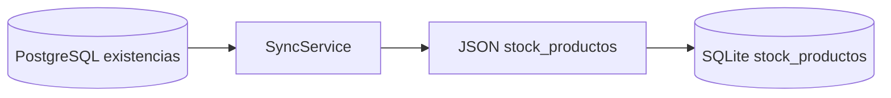

# Sincronización de catálogos

## Endpoint

```http
GET /api/sync/catalogos/{nombre}?page=0&size=500&updatedAfter=<ISO_DATE_TIME>
Authorization: Bearer <ACCESS_TOKEN>
```

Spring Security deja públicos solo los endpoints `/api/auth/**`; los catálogos requieren un JWT Bearer válido. `SyncViewModel` usa el plugin Bearer de Ktor y el refresh token para renovar una sesión ante HTTP 401.

La respuesta contiene:

```json
{
  "page": 0,
  "totalPages": 1,
  "totalElements": 0,
  "data": []
}
```

## Paginación

Kotlin solicita páginas de 500 registros hasta alcanzar `totalPages`. El backend normaliza `page >= 0`, `size >= 1`, ordena por una clave estable y aplica `LIMIT/OFFSET`.

## Timestamps e incremental

El ERP actual incorpora `created_at` y `updated_at` mediante `20260820_sync_catalog_timestamps.sql`; triggers PostgreSQL inicializan ambos al insertar, conservan `created_at` y renuevan `updated_at` al actualizar.

El contrato actual utiliza principalmente `updatedAt`. Kotlin obtiene `MAX(updated_at)` local y lo envía como `updatedAfter`; el backend filtra con `updated_at > :updatedAfter`. En la segunda sincronización solo deben regresar filas posteriores al cursor.

`createdAt` se expone actualmente en `kits_detalle`; no forma parte de todos los DTO de catálogo. La existencia de `created_at` en PostgreSQL no implica que todos los JSON lo publiquen.

## Catálogos actuales

La lista de `SyncViewModel` contiene 18 nombres:

1. `clientes`
2. `productos`
3. `precios_producto`
4. `stock_productos`
5. `series_folios`
6. `series_folios_usuarios`
7. `usuarios`
8. `agentes`
9. `unidades_medida`
10. `categorias`
11. `impuestos`
12. `productos_impuestos`
13. `productos_sustitutos`
14. `marcas`
15. `pedidos`
16. `detalle_pedidos`
17. `kits_detalle`
18. `clientes_ubicaciones`

`SyncService` reconoce los mismos nombres. `detalle_pedidos` aparece en el GET y se descarga, pero `SyncViewModel` no tiene una rama que persista ese catálogo recibido en SQLite; cae en el mensaje de catálogo sin método de guardado. Esto no impide el flujo actual Kotlin -> ERP: los detalles de pedidos capturados localmente sí se guardan mediante `PedidoRepository` y sí se envían por POST. El backend marca el catálogo GET `detalle_pedidos` como no incremental.

## Estrategia local

Las tablas de catálogo usan claves primarias naturales o compuestas y sentencias `INSERT OR REPLACE`. Cada página se guarda en una transacción SQLDelight. La estrategia actual actualiza filas recibidas, pero no elimina localmente registros borrados en ERP salvo casos especiales.

## Stock

La transformación vigente es:



La consulta de `stock_productos` en `SyncService` lee `public.existencias` y mapea:

- `almacen_id` -> `idUbicacion`;
- `producto_id` -> `idProducto`;
- `cantidad_disponible` -> `cantidad`;
- `updated_at` -> `updatedAt`.

La tabla PostgreSQL `stock_productos` no es la fuente usada por esta integración.

### Semántica comercial del stock sincronizado

`stock_productos` en SQLite representa la última existencia conocida al momento de la sincronización. Es información de apoyo para el vendedor, no una reserva ni una garantía de disponibilidad.

Reglas vigentes:

- existencia suficiente: el pedido puede capturarse;
- existencia menor a la cantidad solicitada: el pedido también puede capturarse por la cantidad completa;
- existencia cero: el producto sigue siendo vendible si está activo y tiene precio válido;
- capturar o recibir un pedido no modifica `existencias`;
- la disponibilidad real se decide después en autorización/surtido y puede derivar en entrega parcial, backorder o compra a proveedor.

La sincronización incremental de `stock_productos` debe seguir usando `updated_at` para refrescar el snapshot cuando haya conexión.

## Kits

Aunque el backend admite filtro incremental para `kits_detalle`, Kotlin no calcula cursor para ese nombre. Antes de descargarlo ejecuta `deleteAllProductosKits()`, por lo que cada sincronización vuelve a obtener y reconstruir el catálogo completo.

## Evidencia de volumen

Existe `FirstSyncSmokeTest`, que ejecuta login y dos sincronizaciones, contabiliza páginas, registros y errores. Los valores aproximados reportados durante la validación reciente fueron 71,898 productos y 71,896 filas tanto de precios como de productos-impuestos. Esas cifras son un resultado de validación registrado, no una propiedad permanente ni un reporte conservado actualmente en los artefactos de prueba.
