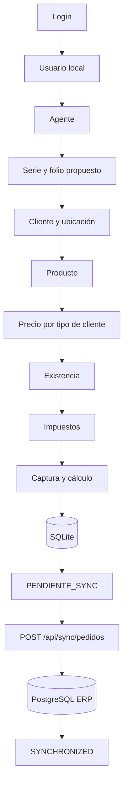

# Flujo completo del pedido

## Selección y captura

1. `LoginRepository` autentica y `AuthLocalDataSource` guarda `UserSession`.
2. `PedidoRepository.getUsuario` y `getAgentePorUsuario` resuelven usuario y agente.
3. `getSeriesPorUsuario` limita las series permitidas.
4. El primer folio propuesto proviene de `series_folios`; capturas posteriores usan los folios de `folioSeries_pedidos`.
5. Se selecciona cliente y ubicación.
6. El precio se consulta en `precios_producto` usando `clientes.numero_precio_id`.
7. El stock visible es la suma local de `stock_productos`, usado solo como snapshot informativo.
8. Los impuestos se obtienen por `productos_impuestos` e `impuestos`.
9. `NuevoPedidoViewModel` calcula subtotal, descuento, impuestos y total.

## Persistencia SQLite

`PedidoRepository.guardarPedidoLocal` genera un `uuid_local` UUID, crea el encabezado y sus detalles dentro de una transacción y deja:

- `uuid_server = null`;
- `estado = PENDIENTE_SYNC`;
- `synced_at = PENDIENTE_SYNC`;
- folio local reservado en `folioSeries_pedidos`.

La captura local no modifica `stock_productos`; `LocalPedidoCaptureSmokeTest` compara stock antes y después. La existencia no bloquea la captura: se permite registrar la cantidad completa aunque el stock local sea cero o menor a la cantidad solicitada.

## Envío

`SyncViewModel.syncPedidosPendientes` consulta `getPedidosPendientesSync`, construye `PedidoConDetallesDTO` y envía cada pedido a `/api/sync/pedidos` con Bearer. La cola local de pendientes se procesa ordenada por `id_pedido ASC`.

El backend:

- valida cliente, agente, serie, producto activo, cantidad positiva y precio válido;
- bloquea la serie;
- resuelve el folio definitivo;
- persiste `pedidos` y `detalle_pedidos`;
- calcula y serializa impuestos;
- avanza `siguiente_folio`;
- devuelve `uuidServer`, folio, serie e indicador de idempotencia.

Kotlin guarda el folio definitivo y `uuid_server`, y cambia `estado` y `synced_at` a `SYNCHRONIZED`.

La recepción del pedido en backend tampoco modifica `existencias`. El pedido recibido queda disponible para el flujo posterior de matriz: autorización comercial y surtido.

## Cola offline y reconexión

La validación offline de una laptop confirmó:

- varios pedidos pueden capturarse con el backend no disponible;
- cada pedido queda en SQLite con `estado = PENDIENTE_SYNC` y `synced_at = PENDIENTE_SYNC`;
- los folios locales se asignan consecutivamente a partir del último folio conocido;
- al recuperar conexión, la cola se envía secuencialmente;
- cada pedido confirmado se actualiza a `SYNCHRONIZED` y recibe identificador servidor;
- un HTTP 4xx/5xx conserva el pedido pendiente;
- una excepción de red conserva el pedido pendiente;
- un fallo de un pedido no corrompe la cola ni marca pedidos no confirmados;
- reintentos posteriores vuelven a procesar únicamente los pendientes;
- si el backend ya guardó el pedido pero la laptop perdió la respuesta, el reintento con el mismo `uuid_local` recupera el pedido existente sin duplicar;
- una sincronización incremental posterior de catálogos no altera pedidos, UUID, folios ni estados locales.

Los errores de red quedan reflejados en `message`, de modo que ya no se confunden silenciosamente con una sincronización exitosa.

Estado local al cierre de esta validación:

| Recurso | Valor |
| --- | ---: |
| PostgreSQL `pedidos` | 5 |
| PostgreSQL `detalle_pedidos` | 5 |
| PostgreSQL serie 10 `siguiente_folio` | 5 |
| SQLite `pedidos` | 5 |
| SQLite `detalle_pedidos` | 5 |
| SQLite pendientes | 0 |

Estos valores son evidencia de la base local de validación, no requisitos ni datos iniciales del sistema.

## Autorización y surtido

`pedido recibido`, `pedido autorizado` y `pedido surtido` son conceptos distintos:

- **Recepción:** el backend registra lo solicitado por el vendedor.
- **Autorización comercial:** debe decidirse en matriz, principalmente con base en cartera, mora, crédito bloqueado, límite/plazo y reglas comerciales del cliente.
- **Surtido:** almacén debe determinar cuánto se entrega realmente. Puede haber surtido parcial si el cliente/pedido lo permite.

El modelo actual ya contiene campos para cantidades solicitadas, autorizadas, reservadas, surtidas y canceladas en `detalle_pedidos`. También existen tablas estructurales para `pedido_estados`, `pedidos_autorizaciones` y `pedidos_estados_historial`, pero en el backend PEDIDOS inspeccionado todavía no están implementados los endpoints administrativos/surtido que consume React.

Si no hay existencia suficiente, el pedido no se rechaza automáticamente: puede generar surtido parcial, backorder o una necesidad de compra posterior.

## Identificadores

- `uuid_local`: clave estable generada antes del envío; identifica el mismo intento lógico durante reintentos.
- `uuid_server`: actualmente contiene `pedidos.id_pedido` devuelto por el backend, serializado como texto en SQLite.
- Folio local: propuesta útil para trabajo offline.
- Folio servidor: valor definitivo después de aplicar bloqueo, secuencia y restricciones ERP.
